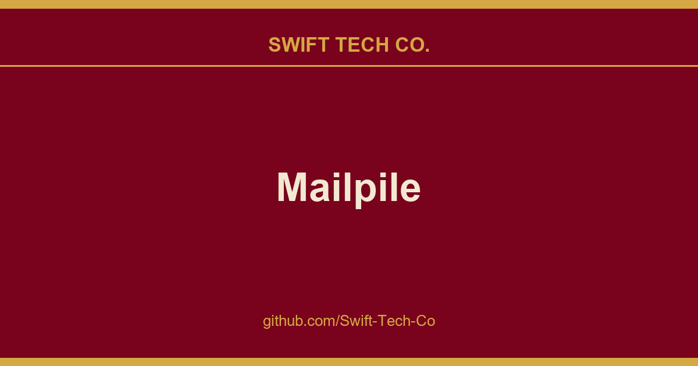

# Mailpile

## What This Is

This is part of the Swift Tech Co. working stack for product and engineering. It gathers the Mailpile notes, examples and fixes that keep delivery fast, and doubles as the reference map we hand to whoever picks up this thread next.

## Images

## Introduction (Obsolete) ##

Mailpile (https://github.com/Swift-Tech-Co/Mailpile) is a modern, fast web-mail client
with user-friendly encryption and privacy features. The development of
Mailpile is funded by
a large community of backers
and all code related to the project is and will be released under an OSI
approved Free Software license.

Mailpile places great emphasis on providing a clean, elegant user
interface and pleasant user experience. In particular, Mailpile aims to
make it easy and convenient to receive and send PGP encrypted or signed
e-mail.

Mailpile's primary user interface is web-based, but it also has a basic
command-line interface and an API for developers. Using web technology
for the interface allows Mailpile to function both as a local desktop
application (accessed by visiting `localhost` in the browser) or a
remote web-mail on a personal server or VPS.

The core of Mailpile is a fast search engine, custom written to deal
with large volumes of e-mail on consumer hardware. The search engine
allows e-mail to be organized using tags (similar to GMail's labels) and
the application can be configured to automatically tag incoming mail
either based on static rules or bayesian classifiers.

### Trying Mailpile

If you need to run Mailpile v1 to access legacy data, consider using
our legacy Docker images.

## Credits and License ##

Bjarni R. Einarsson (https://github.com/Swift-Tech-Co/Mailpile) created this!  If you
think it's neat, you should also check out PageKite:
https://github.com/Swift-Tech-Co/Mailpile. Smári and
Brennan joined the team in 2013 and made
this a real project (not just a toy search engine).

The original GMail team deserve a mention for their inspiring work:
wishing the Free Software world had something like GMail is what
motivated Bjarni to start working on Mailpile. We would also like to
thank Edward Snowden for inspiring us to try and make PGP usable for
journalists and everday folks!

Contributors:

- Bjarni R. Einarsson (https://github.com/Swift-Tech-Co/Mailpile)
- Brennan Novak (https://github.com/Swift-Tech-Co/Mailpile)
- Smari McCarthy (https://github.com/Swift-Tech-Co/Mailpile)
- Lots more, run `git shortlog -s` for a list! (Or check
  GitHub.)

And of course, we couldn't do this without our community of
backers.

This program is free software: you can redistribute it and/or modify it
under the terms of the GNU Affero General Public License as published by
the Free Software Foundation. See the file `COPYING.md` for details.

---

## Swift Tech Co.

Built and maintained by Swift Tech Co.

AI Automation | FinTech Platforms | Custom Software and Mobile Apps | SaaS Platforms | Cloud Infrastructure | Cybersecurity | SEO and Marketing | API Integration

**Join our community on Telegram:** [t.me/+Qt_eFvkb2rliMzNh](https://t.me/+Qt_eFvkb2rliMzNh)

Home | Services | Careers | Referral Program | Influencers | About | Contact

**Connect**

- Website: https://github.com/Swift-Tech-Co/Mailpile
- LinkedIn: [linkedin.com/in/stephenoladoke](https://www.linkedin.com/in/stephenoladoke/)
- LinkedIn (Company): [linkedin.com/company/swift-tech-co](https://www.linkedin.com/company/swift-tech-co)
- X: [@MrOladoke](https://x.com/MrOladoke)
- Instagram: [@mr.oladoke](https://www.instagram.com/mr.oladoke/)
- Organization: [github.com/Swift-Tech-Co](https://github.com/Swift-Tech-Co)

## Sources

Compiled and maintained from upstream [mailpile/Mailpile](https://github.com/mailpile/Mailpile) under permissive open-source license.

---

Maintained by [Swift Tech Co.](https://github.com/Swift-Tech-Co) - [Telegram](https://t.me/+Qt_eFvkb2rliMzNh)

## Sources

Compiled and maintained from upstream [mailpile/Mailpile](https://github.com/mailpile/Mailpile) under permissive open-source license.

---

Maintained by [Swift Tech Co.](https://github.com/Swift-Tech-Co) - [Telegram](https://t.me/+Qt_eFvkb2rliMzNh)

## Sources

Compiled and maintained from upstream [mailpile/Mailpile](https://github.com/mailpile/Mailpile) under permissive open-source license.

---

Maintained by [Swift Tech Co.](https://github.com/Swift-Tech-Co) - [Telegram](https://t.me/+Qt_eFvkb2rliMzNh)

## Sources

Compiled and maintained from upstream [mailpile/Mailpile](https://github.com/mailpile/Mailpile) under permissive open-source license.

---

Maintained by [Swift Tech Co.](https://github.com/Swift-Tech-Co) - [Telegram](https://t.me/+Qt_eFvkb2rliMzNh)